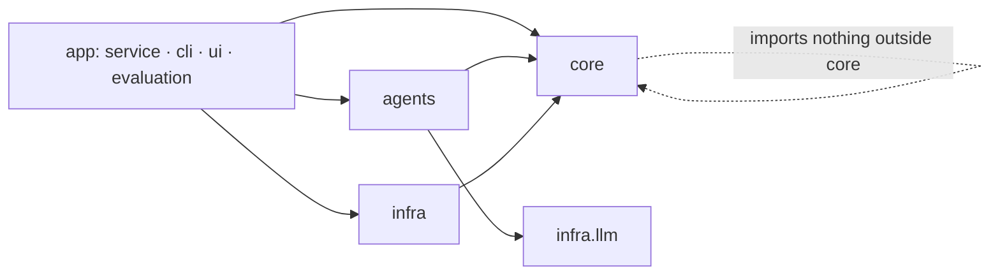

# Architecture Spine — AutonomousPrime target architecture

## Design Paradigm

**Functional core, imperative shell**, with **LLM-Modulo** generate-and-test inside it: code generates the options and verifies every choice; the LLM chooses and explains.

| Layer | Package | May do |
|---|---|---|
| Core (pure, deterministic) | `autonomousprime.core` | world, time, contracts, menus, rules, cost, mediator, policy, fallback, decision record. No file, network, env or clock access (time passed in). |
| Agents | `autonomousprime.agents` | per-role view → prompt → LLM (through `infra.llm`) → parse → code enforcement; dry-run policy for tests. |
| Infra (I/O) | `autonomousprime.infra` | data loading and caching, workbook limits, LLM client, consensus log writer, settings. |
| App (entry points) | `autonomousprime.service`, `.cli`, `.ui`, `.evaluation` | wire core + agents + infra for one run or a batch. |

## Invariants & Rules



### AD-1 — Code decides; the LLM proposes, chooses and explains [ADOPTED; amended 2026-11-11, ADR-0004]

- **Binds:** all agents, mediator, fallback; R5
- **Prevents:** LLM arithmetic, LLM legality checks, LLM-decided termination or pick.
- **Rule:** an LLM output may contain ids of code-generated options, scores/votes, flags from a closed enum, short text, and proposals (a plan, or a relaxed bound in a concession) in the contract's typed fields. Code validates every proposal and recomputes every number from the world before it counts; a number in free text is ignored. Every plan an agent accepts or proposes is re-checked by `core.rules` before it counts. Choosing only from code menus is today's default, not this rule (register G3).

### AD-2 — One role, one call, own facts [DEFAULT, ADR-0004]

- **Binds:** `agents/*`; R5
- **Prevents:** merged-role prompts; one agent reading another's private state.
- **Rule:** roles come from one registry (today `atc`, `pilot`, `ground`); the mediator, contracts, report and UI iterate it and never hard-code the set. An agent's prompt is built only from `world.view(role)`. Other agents are visible only through the shared message (`action`, `plan_id`, `reason`, `flags`). A test asserts each view excludes the other roles' private fields.

### AD-3 — Safety is a filter, applied before cost [ADOPTED, ADR-0002]

- **Binds:** `core.rules`, `core.cost`, `core.mediator`, `core.fallback`
- **Prevents:** trading a hard rule for money.
- **Rule:** `rules.check(plan, world)` runs before `cost(plan, world)`; hard rules have no price; the mediator and the fallback each re-check their output before returning it.

### AD-4 — One immutable world per run

- **Binds:** `core.world`, every consumer; R2, R6, R7
- **Prevents:** four builders disagreeing on the disrupted arrival, the scheduled gate or "now" (review F1).
- **Rule:** `build_world(rows, focal, seed, limits, config) -> WorldState` is called once per run; `WorldState` is a frozen dataclass; every derived time is computed there; every synthetic field carries a provenance label (`real | derived | workbook | synthetic`). Agents, fallback and evaluation receive the world or a view; none re-reads the CSV.

### AD-5 — Rule registry: one implementation per rule id

- **Binds:** `core.rules`; R2, R6
- **Prevents:** shadowed or duplicated rules (review F2).
- **Rule:** each rule id (`C-CAP-1`, `C-WAKE-1`, `C-FUEL-1`, `C-CREW-1/2`, `C-GATE-1/2`, `C-TURN-1`, flags `MINIMUM_FUEL`/`EMERGENCY_FUEL`) is one registered function with severity `hard | soft | flag` and an owner role. Only `core.rules` emits rule ids. Meanings of existing ids never change; a changed limit is a new config value, a changed meaning is a new id.

### AD-6 — Bounded, configurable negotiation (supersedes ADR-0003's fixed three rounds)

- **Binds:** `core.policy`, `core.mediator`; R5
- **Prevents:** unbounded loops (brief) and a hard-coded round count spread across mediator, bridge and UI (review F10).
- **Rule:** `NegotiationPolicy(max_rounds, deadline_s, max_llm_calls, require_concession)` is the only place limits live; default `max_rounds = 3`. The mediator stops on: unanimous accept of a checked plan → consensus; round cap, deadline or budget reached, or a round with no new valid plan or concession → fallback. A policy may add other bounded exits decided by code, such as a re-vote on the runner-up or a hand-over to the human (register G2). The outcome records the actual rounds used. Only code decides termination.

### AD-7 — All LLM access goes through `infra.llm`

- **Binds:** `agents/*`, document crafter; R2, R9
- **Prevents:** three integrations with different retries, parsing, caching and logs (review F8).
- **Rule:** only `infra/llm.py` imports an LLM SDK (today `anthropic`); an agent framework or another provider needs an ADR (ADR-0004, register G4). It provides: async client, structured output via Pydantic (`messages.parse`), cached system prompt, retry once then a typed failure (the agent turns it into `reject`), response cache keyed by (model, system, messages, schema), and one JSONL call log with request id, usage, latency and stop reason. Model per role comes from settings.

### AD-8 — No hindsight, by construction

- **Binds:** `infra.data`, `core.world`, `evaluation`; R2
- **Prevents:** three diverging hindsight lists; outcome data leaking into a prompt.
- **Rule:** `infra.data` returns flight rows without outcome columns (`DEPARTURE_TIME`, `ARRIVAL_TIME`, `ARRIVAL_DELAY`, `DEPARTURE_DELAY`, `WHEELS_*`, `ELAPSED_TIME`, `AIR_TIME`, `TAXI_*`, other delay causes, `DIVERTED`, `CANCELLED*`). Outcomes come only from `data.outcomes(flight_key)`, imported only by `evaluation/`; a test enforces the import boundary.

### AD-9 — One append-only log per run, ending in the human's decision

- **Binds:** `infra.log`, `core.report`, `ui`; R8
- **Prevents:** an audit trail that stops before the decision (review F9); records that state facts not in the log.
- **Rule:** every mediator step, LLM call reference, fallback and human decision is one versioned JSONL line (schema in `core.contracts`). The decision record and the UI read the log; they compute nothing new.

### AD-10 — Weights and limits live in config, with provenance

- **Binds:** `core.cost`, `infra.limits`; R2, R6
- **Prevents:** three copies of cost weights and literal numbers in evaluation (review F3).
- **Rule:** cost weights are in `config/cost.toml`, each with a source label; operational limits come from the organiser workbook via `infra.limits` as the default config, overridable per airport; every override carries its own source label (register S3). No numeric weight or limit literal appears outside config and tests.

### AD-11 — The golden master gates behaviour [amended 2026-11-11, ADR-0004]

- **Binds:** every refactor commit; R1
- **Prevents:** a "pure refactor" silently changing published numbers.
- **Rule:** `tests/golden/` holds the dry-run plans, costs, outcomes, rule ids and round counts of the evaluation sample and the five demo rows; reason text, log wording and decision-record prose are not pinned (epic-one-core story 12 narrows today's byte-identical snapshot). Refactor commits leave it unchanged. A commit that changes behaviour, including a bug fix inside a refactor epic, is its own commit, updates the snapshot and states which numbers moved and why.

## Consistency Conventions

| Concern | Convention |
| --- | --- |
| Roles | Lower-case role ids from the role registry (today `atc`, `pilot`, `ground`) in contracts, logs and config keys; nothing outside the registry lists them (AD-2). |
| Ids | Rule `C-<AREA>-<n>`; candidate plan `C<n>`; fallback plan `F<n>`; run `<DEST>-<YYYYMMDD>-<AIRLINE><FLIGHT>-s<seed>-<UTC timestamp>`. |
| Time | Target: absolute local time inside core (service date + minutes after local midnight + the airport's timezone), so overnight arrivals, duty clocks and several airports work (register W2, epic-plans-time-and-events). Until then, integer minutes after local midnight. `"HH:MM"` only for display; DOT `"2400"`/zero-padded strings parsed only in `core.timeutil`. |
| Money | USD floats; round only when rendering. |
| Errors | Rule failures are data (`CheckResult`), never exceptions. Exceptions only for programmer errors or missing input data. |
| Async | Agents and mediator are `async`; no sync client wrapped in `to_thread`. |
| Config & env | `.env.local` read once by the entry point; core never reads env. Settings object passed in. |
| Logging | Run log via `infra.log`; LLM call log via `infra.llm`; both under `logs/<run id>/`. No `print` in core or agents. |
| Prompts | `agents/<role>/prompt.md`, loaded by `infra.llm` at call time, not at import. |
| Tests | `tests/unit/<package path>`, `tests/golden/`, `tests/live/` (marked, skipped without a key). |

## Stack

| Name | Version |
| --- | --- |
| Python | 3.13 |
| anthropic | 2.3.0 |
| pydantic | 2.14.2 |
| streamlit | 1.66.1 |
| openpyxl | 3.1.5 |
| python-dotenv | 1.2.4 |
| pytest | 9.2.0 |
| ruff (dev) | [ASSUMPTION] latest at adoption |
| CI | [ASSUMPTION] GitHub Actions |

## Structural Seed

```text
pyproject.toml                # [ASSUMPTION] package `autonomousprime`, src layout
config/
  cost.toml                   # weights + source labels (AD-10)
  negotiation.toml            # NegotiationPolicy defaults (AD-6)
src/autonomousprime/
  core/
    timeutil.py  contracts.py  world.py  menu.py  gates.py
    rules/       # registry.py + capacity.py fuel.py crew.py gate.py (AD-5)
    cost.py  policy.py  mediator.py  fallback.py  report.py
  agents/
    base.py      # LLM-backed agent template + dry-run policy hook
    atc/  pilot/  ground/      # facts.py (view → facts), policy.py (code ranking), prompt.md
  infra/
    data.py  limits.py  llm.py  log.py  settings.py
  service.py     # negotiate(flight_key, seed, policy, live) -> RunResult
  cli.py         # python -m autonomousprime run | eval | cache-demo
  evaluation/    # one harness, baselines, report writer
  ui/app.py      # the one Streamlit console
tests/  unit/  golden/  live/
scripts/fetch_data.py          # [ASSUMPTION] if flights.csv leaves git
docs/  (README, architecture, adr/, RESULTS.md, hackathon/ archive)
```

Where today's code goes:

| Today | Target |
|---|---|
| `mediator/core.py` | `core/mediator.py` (+ `core/policy.py`) |
| `mediator/adapters.py` `check_plan`, `plan_cost`, `_key_*`, proposers | `core/rules/`, `core/cost.py`, `agents/<role>/policy.py` |
| `mediator/report.py` | `core/report.py` |
| `atc-agent/atc_agent/world_stub.py`, `ground_agent/inputs.py`, `agents/pilot_inputs.py`, `fallback/world.py` | `core/world.py` (+ `infra/data.py` for CSV) |
| `atc-agent/atc_agent/menu.py` | `core/menu.py` (`check_slot` → `core/rules/capacity.py`) |
| `ground_agent/checker.py`, `options.py`, `cost.py` | `core/rules/gate.py`, `core/gates.py`, `core/cost.py` |
| `agents/pilot.py` (`assess_plan`, `fuel_budget`) | `core/rules/fuel.py`, `core/rules/crew.py`, `agents/pilot/` |
| `agents/constraints.py`, `atc_agent/config.py` workbook readers | `infra/limits.py` |
| `agents/schema.py`, `atc_agent/schema.py`, `mediator.core.ScoredPlan/Vote` | `core/contracts.py` |
| ATC/Pilot/Ground LLM code | `agents/base.py` + `infra/llm.py` |
| `fallback/scenario.py` | `core/fallback.py` (standalone `fallback/world.py`, `rules.py`, `solver.py` deleted) |
| `middleman.py`, `mediator/run.py`, `make_cache.py`, `demo_rows.py` | `service.py`, `cli.py`, `tests/golden/fixtures` |
| `evaluation/`, `mediator/eval_batch.py` | `evaluation/` |
| `app_prime.py` (`app.py` deleted) | `ui/app.py` |

## Capability → Architecture Map

| Capability / Area | Lives in | Governed by |
| --- | --- | --- |
| R1 golden master | `tests/golden/` | AD-11 |
| R2 one implementation per concern | `core/*`, `infra/*` | AD-4, AD-5, AD-7, AD-8, AD-10 |
| R3 one entry point, UI, evaluation | `service.py`, `cli.py`, `ui/`, `evaluation/` | paradigm (app layer) |
| R4 dry run < 2 s | `infra/data.py` cache | AD-4 |
| R5 real, bounded negotiation | `core/policy.py`, `core/mediator.py`, `agents/*` | AD-1, AD-2, AD-6 |
| R6 bug fixes with numbers | `core/world.py`, `core/rules/`, `core/cost.py` | AD-4, AD-5, AD-10, AD-11 |
| R7 airborne + diversion | `core/world.py`, `core/menu.py`, `core/fallback.py` | AD-3, AD-4, AD-5 |
| R8 human decision logged | `infra/log.py`, `ui/app.py` | AD-9 |
| R9 evaluation at scale | `evaluation/` | AD-7 (cost/latency from the call log), AD-8 |
| R10 instructions current | `CLAUDE.md`, `AGENTS.md` | — |

## Deferred

Each item is "not yet", with the trigger that brings it in (register P4). None is ruled out.

- **Deployment target** for the UI (Streamlit Community Cloud, container, local only): not needed until someone outside the team runs it.
- **Persistence beyond JSONL** (database, run index): JSONL per run is enough until runs are browsed across sessions.
- **Multi-flight negotiation** (several Pilot agents sharing one slot menu): needs its own AD on slot allocation between Pilot agents; decide when the initiative scopes it.
- **Real data sources** (full BTS on-time data, METARs, real gate maps): waits on the data-storage question; the world builder's provenance labels already allow mixing.
- **Static typing** (mypy/pyright): useful after the package move; not required by any R line.
- **Another front end or an API** beside or instead of Streamlit: when a user outside the duty-manager console needs it (register S1, U1).
- **Agent framework or another LLM provider**: when a need the gateway cannot meet appears; needs an ADR (AD-7).
- **Realism the hackathon framing put out of scope** (live operational feeds, real gate layouts, FAA Part 117 crew legality, RECAT/CWT wake categories, aircraft type enrichment): when a data source exists for it; each lands as a world field with provenance and, if it is a rule, a new rule id.
